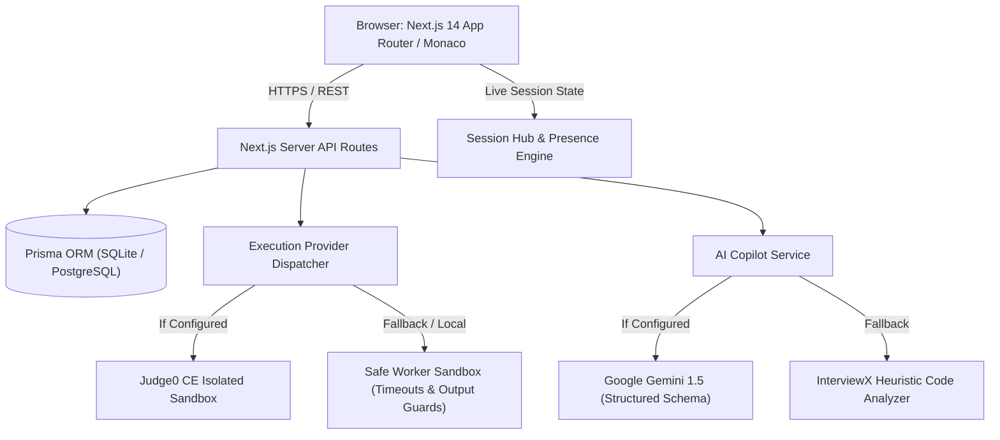

# InterviewX — Architecture Specification & System Design

## 1. System Overview
**InterviewX** is an evidence-based live technical interview and assessment platform designed to replace subjective whiteboard evaluations with reproducible engineering data.

---

## 2. Core Architectural Pillars

### A. Isolated Code Execution Engine
Untrusted source code submitted by candidates is strictly isolated:
- **Provider Interface (`IExecutionProvider`)**: Standardized contract with methods `execute(request)` and `isConfigured()`.
- **Judge0 CE Adapter**: Connects to Judge0 CE (RapidAPI or self-hosted) with configurable CPU wall-clock limits (2.5s default), memory ceiling (128 MB), and non-privileged containers.
- **Safe Local Sandbox Adapter**: An isolated worker process runner with process isolation, stdin pipe feeding, strict timeout guards (terminates with exit code 124 upon overrun), output buffer truncation (prevents memory bombing), and blacklisted hazardous system patterns.

### B. Deterministic Assessment & Scoring
- Machine evaluation evaluates functional correctness by executing code against public test cases and confidential hidden test cases.
- String and JSON output normalizers prevent false failures due to CRLF line breaks or object key ordering.
- Hidden test inputs and outputs are evaluated server-side and sanitized before reaching candidate client responses.

### C. Live Collaborative Workspace
- Integrated Monaco Editor with syntax highlighting, automatic theme synchronization (`vs-dark` / `vs`), line numbers, and font zooming.
- Multi-question navigation allowing interviewers to assign multiple progressive challenges in a single session.
- Authoritative server-side countdown timer preventing client-side countdown manipulation.

### D. Responsible Advisory AI Copilot
- Integrates Google Gemini 1.5 with Zod schema validation.
- Generates algorithmic complexity estimation, candidate approach summaries, and dynamic interviewer follow-up probes.
- AI observations are transparently marked as advisory; hiring decisions require human verification.

---

## 3. Threat Boundaries & Data Privacy
- Zero client bundle exposure of provider API keys (`AUTH_SECRET`, `JUDGE0_API_KEY`, `GEMINI_API_KEY` are server-only).
- No invasive candidate biometric surveillance or audio/webcam monitoring.
- Cryptographic session invitation tokens (`ivx-` prefix with 24-character high-entropy hex).
